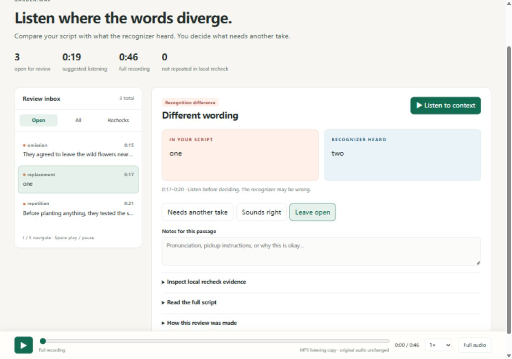

# Saydelta

**Hear the passages where your recording and script disagree.**

Saydelta compares an English voiceover with its script and creates a single, offline HTML review. Click a suspected missing sentence, repeated passage or changed word; hear the context; record whether it needs another take. Send the same report to a collaborator without setting up a server.

Built for creators reviewing ordinary-vocabulary, synthesized English narration. It flags recognition differences, **not verified mistakes**. Names, accents and noisy or human audiobook recordings can produce many false alarms. It does not assess pronunciation, emotion, clipping or overall sound quality.



**Try without installing:** download and open [the self-contained example](https://github.com/WtxwNs/saydelta/releases/download/v0.1.0/garden-review-v2.html) in your browser. Its 47-second synthetic recording has three disclosed, deliberate faults: a missing sentence, a changed number and a repeated sentence. [Original audio](examples/garden.wav), [script](examples/garden.txt), [edit record](examples/edits.json).

[40-second walkthrough](docs/walkthrough.mp4) · [中文快速入门](docs/quickstart.zh-CN.md) · [Validation and counterexamples](docs/validation.md)

The walkthrough uses edited still captures of actual browser operations, held for reading, with no audio; it is not real-time processing footage. Open the report to hear the actual recording.

[Download the preview release](https://github.com/WtxwNs/saydelta/releases/tag/v0.1.0) — source ZIP, Python wheel and standalone example.

## Start locally

Python 3.10 or newer is required. From a checkout of this repository:

```sh
python -m venv .venv
# Windows: .venv\Scripts\activate
# macOS / Linux: source .venv/bin/activate
python -m pip install -e ".[asr]"
saydelta fetch-model models/small.en
saydelta check examples/garden.wav examples/garden.txt --model models/small.en --offline -o review.html
```

Open `review.html` in a current browser. The script is UTF-8 plain text; WAV, MP3 and other formats supported by the bundled decoder are accepted. CPU is the default; no GPU or external ffmpeg executable is required. `fetch-model` downloads the free `small.en` recognition model (about 484 MB), in addition to Python dependencies, using standard verified HTTPS with progress and up to three attempts per file. Run it once into an empty folder, then reuse that folder. Download time is separate from recognition time.

Replace the two example paths with your own recording and script. On the tested Windows machine the example's recognition plus rechecks took about 7 seconds, excluding model loading, downloads, decoding and report encoding. This is an example measurement, not a hardware-independent promise.

Windows PowerShell can block activation scripts. You do not need to change that policy: run `.venv\Scripts\python.exe -m pip install -e ".[asr]"`, then use `.venv\Scripts\saydelta.exe` instead of `saydelta` in the two commands above. On other platforms the equivalent direct executable is `.venv/bin/saydelta`.

For an already downloaded CTranslate2 model:

```sh
saydelta check recording.wav script.txt --model /path/to/small.en --offline -o review.html
```

Files are limited to 20 minutes, 512 MB and 100,000 script characters. Split longer work into chapters. Existing reports are never overwritten. Recognition needs available CPU and memory; Windows with Python 3.12 and 3.14 has been exercised. Other platforms are not yet verified.

If a download fails, the error lists completed files. Retry into a new empty folder after checking the connection; no existing model files are overwritten. Alternatively obtain `config.json`, `tokenizer.json`, `vocabulary.txt` and `model.bin` from the [official small.en files](https://huggingface.co/Systran/faster-whisper-small.en/tree/main) and put them together in one folder. TLS verification remains enabled. Omitting `--model` uses faster-whisper's own download/cache path; that path failed with an SSL EOF in the independent check on this network, so explicit model preparation is recommended.

## Review and share

- Choose a passage and **Listen to context**. The model may be wrong.
- Mark **Needs another take**, **Sounds right**, or leave it open. Add pickup notes.
- **Save decisions** exports a small JSON file; **Load decisions** restores it for the same report. Browser storage is a convenience, not a backup.
- Share the HTML and, if needed, the decisions JSON. The HTML contains the full script and a compressed mono listening copy of the recording. Treat it as the recording itself when deciding whom to share with.
- **Rechecks** retains discrepancies that were not reproduced in a second local recognition pass. A clear inbox does not certify a correct recording.

The report makes no network requests and uses no hosted assets, accounts or telemetry. Audio recognition happens locally. Model retrieval contacts the model host only when needed; use `--offline` to prohibit it. Original audio is never modified. The embedded MP3 is for word review, not mastering.

## Why another tool?

Listening end to end remains the trustworthy baseline. ASR plus a text diff can reveal the same word differences, but you must find and track them in the recording. Saydelta combines timestamped listening, review decisions, notes and a portable file.

[TTSProof](https://github.com/Mormolykos/ttsproof) provides broader automatic audio checks and WER-based QA; integrated audiobook generators also provide QA within their generation workflow. Setting TTSProof's WER threshold to zero also flags the controlled changes in our comparison. Saydelta is a standalone human review workflow for recordings you already have. It does not claim a better speech recognizer or replace their signal-quality checks. Read the [paired comparison and failed human-audiobook test](docs/validation.md); no independent user adoption is claimed.

## Development status

Pre-release. The real recognition-to-report path, clean package installation and offline inference have been independently reproduced; the original automatic model download failed on this network and prompted the explicit download command above. See the [independent review](research/independent-review.md) and [project state](PROJECT_STATUS.md). Do not treat research examples as a guarantee for your audio. The public repository is available; real-user adoption remains unverified.

MIT source license; separately installed dependencies have their own licenses. See [third-party sources](THIRD_PARTY.md).
